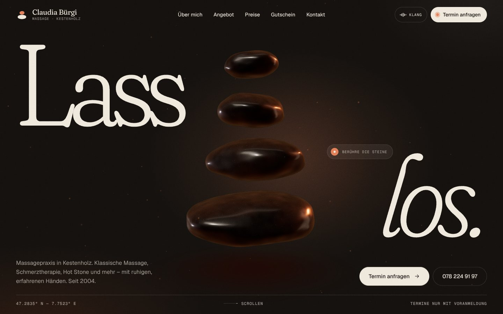
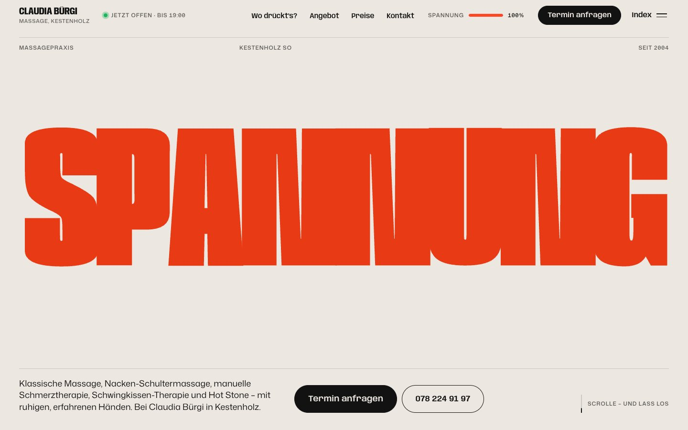

# Massage Claudia Bürgi — three websites

Three complete, independent websites for the massage practice of **Claudia Bürgi** in Kestenholz (SO).
They share one business and one goal: an immersive, award-level experience that still makes booking an appointment as easy as possible.
Each folder is a self-contained static site built with Vite. To publish one, build it and deploy its `dist/` folder.

| | Site | Idea |
| --- | --- | --- |
| 1 | [`sites/1-lass-los`](sites/1-lass-los) | **«Lass los.»** Night, warmth and breath. Hot stones rendered live in WebGL glow when you touch them; there is a guided breathing pause and a price clock. |
| 2 | [`sites/2-entspannung`](sites/2-entspannung) | **«Entspannung»** The letters are muscles. Kinetic variable-font type tenses under the cursor and relaxes, and the page moves from tense red to calm lavender. It adds a body map that suggests a treatment and a press-and-hold relaxation exercise. |
| 3 | [`sites/3-ein-tag`](sites/3-ein-tag) | **«Ein Tag»** A day at the foot of the Jura. The real skyline, built from swisstopo elevation data, is painted live in WebGL with the real sun. The page opens on *now*, then scrolling moves from morning to night. It adds an appointment planner that shows the sky at your hour. |

### 1 — «Lass los.»


### 2 — «Entspannung»


### 3 — «Ein Tag»


## What all three share

- **Booking first.** «Termin anfragen» is always one tap away. The request is composed as a ready-to-send e-mail or SMS, so no server or form service is needed. Tap-to-call is everywhere.
- **Real content, real facts.** All text is semantic HTML that works without JavaScript. The sites publish `HealthAndBeautyBusiness` and FAQ structured data, opening hours with the live status in Europe/Zurich time, and a street map drawn from OpenStreetMap.
- **No tracking.** There are no cookies, no third-party requests and no embeds. Fonts are self-hosted.
- **Accessible and robust.**
  - Keyboard and screen-reader friendly, with `prefers-reduced-motion` support.
  - Fallbacks for no WebGL, no JavaScript and slow fonts.
  - Print styles, Impressum and a 404 page.
- **Tested.** Each site has a `npm run verify` suite of browser checks for booking, menus, focus traps, scroll locks, all screen sizes and fallbacks. Each site also went through independent review rounds.

## Run one

```bash
cd sites/<site>
npm install
npm run dev       # local dev server
npm run build     # static build → dist/
npm run preview   # serve the build
npm run verify    # (with preview running) browser checks
```

Each site's README has its concept, an editing guide (where prices, hours and contact details live) and credits.
