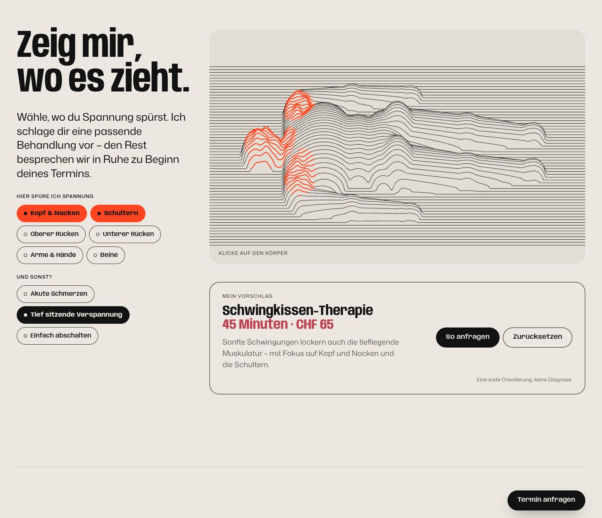
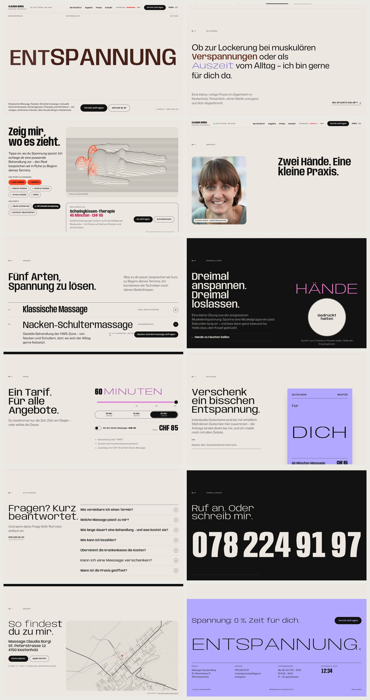
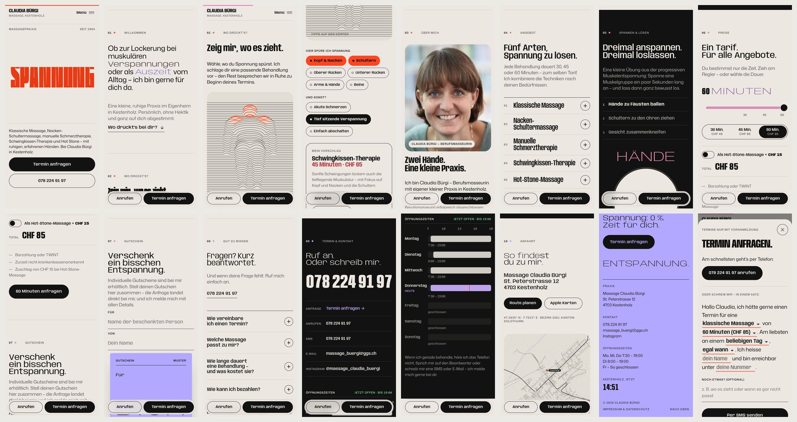

# Massage Claudia Bürgi — «Entspannung»

The second of three websites for the massage practice of **Claudia Bürgi** in Kestenholz (SO).
It is a static build with no backend, no cookies and no tracking.




<details>
<summary>All sections (desktop & mobile)</summary>




</details>

## Concept — the letters are muscles

A massage turns tension into relaxation. This site shows that change in its own typography.
Every headline is set in the variable font **Anybody**, and every letter is a small spring.
Move the pointer close and the letters tense up: narrower, heavier, redder. Leave them alone and they relax: wide, light and calm.
The page goes the same way. It starts tense in signal red and gets calmer the further you scroll, ending in soft lavender at the bottom.

| Moment | What happens |
| --- | --- |
| Loader | A string is pulled taut while a «Spannung» counter climbs, then it lets go. |
| Hero | A huge clenched word **SPANNUNG**. As you scroll it stretches out letter by letter into **ENTSPANNUNG**. A tension gauge in the header drops with it. |
| Willkommen | The welcome lines unclench as they enter the screen. |
| Wo drückt's? | A body lying on the treatment table, drawn in scan lines. Tap where it hurts and red, restless knots appear; rub over them and they settle. A suggested treatment updates as you choose, and «So anfragen» opens the booking sheet already filled in. |
| Über mich | A halftone portrait of Claudia. A loupe follows the pointer and shows the real photo underneath. Her story and the facts. |
| Angebot | The five treatments as expanding rows. Each title relaxes as it opens. |
| Spannen & Lösen | A guided exercise in progressive muscle relaxation. Hold the button for five seconds and the section tenses; let go and it springs loose, overshoots and settles. |
| Preise | Stretch the bar from 30 to 60 minutes. The word «Minuten» stretches with it, and the price follows. Hot Stone is a toggle. |
| Gutschein | A voucher poster whose recipient name always fills the full width. The request is sent as a prepared e-mail or SMS. |
| Gut zu wissen | Short answers to the usual questions, also published as FAQ structured data. |
| Kontakt | A tap-to-call number. The opening hours are shown as a week of bars, with *today* and *now* marked in Europe/Zurich time. |
| Anfahrt | A street map of Kestenholz drawn from OpenStreetMap data, with no embed and no tracking. |
| Footer | «Entspannung.» in fully relaxed letters and «Spannung: 0 %», plus the contact details. |

The booking sheet is a fill-in sentence (*«Hallo Claudia, ich hätte gerne einen Termin für eine … von …»*). It composes an e-mail or an SMS.
The site also includes a custom cursor, smooth scrolling, a mobile action dock, `prefers-reduced-motion` support, print styles, view transitions and a 404 page.

## Business-first details

- «Termin anfragen» is always one tap away: in the header, the hero, the sections and the mobile dock.
- All real content is semantic HTML. It works without JavaScript; the booking links then lead to the contact section.
- The site publishes `HealthAndBeautyBusiness` JSON-LD with address, geo coordinates, opening hours, services, price range and payment methods. It also has an Open Graph image, favicons, a web manifest, `sitemap.xml` and `robots.txt`.
- Fonts are self-hosted, and the page makes **no third-party requests**.
- Lighthouse (production build): desktop 100 / 100 / 100 / 100, mobile 96 / 100 / 100 / 100.

## Development

```bash
npm install
npm run dev       # local dev server
npm run build     # production build → dist/
npm run preview   # serve the build on http://localhost:4174
npm run verify    # (with preview running) 24 browser checks: booking, menu, focus, locks, exercise, sizes, slow fonts, no-JS …
npm run assets    # (with preview running) favicons and share image
```

`verify` and `assets` use Playwright. Run `npm i -D playwright` if it is not installed globally.

The `dist/` folder is a plain static site. Upload it to any static host, such as Netlify, Cloudflare Pages, Vercel, GitHub Pages or a classic web host.
`public/_headers` sets cache and security headers on Netlify and Cloudflare Pages.

## Editing content

All text lives in **`index.html`**. Search for the section comments (`00 Hero`, `02 Wo drückt's?`, `06 Preise` …).

| Change | Where |
| --- | --- |
| Prices | `index.html` (Preise, booking sheet, JSON-LD `priceRange`), `src/js/sections/prices.js` and `src/js/core/booking.js` (`PRICES`, `HOTSTONE`), `src/js/sections/voucher.js` (`GIFTS`) |
| Opening hours | `index.html` (Kontakt `data-open` / `data-close`, footer, JSON-LD), `src/js/utils/helpers.js` (`HOURS`) |
| Phone / e-mail | `index.html`, `impressum/index.html`, `src/js/core/booking.js`, `src/js/app.js` |
| Treatment suggestions | `src/js/sections/bodymap.js` (the recommendation rules) |
| Portrait | `public/images/claudia-buergi.webp` |

## Structure

```
index.html              one-page site (all content)
impressum/index.html    Impressum & Datenschutz
404.html                «Nicht gefunden.»
public/                 fonts, portrait, icons, og-image, manifest, sitemap, robots, _headers
src/js/core/            kinetic letters (springs, frozen line breaks), pointer, scroll locks, loader, header/menu/gauge, cursor, booking sheet
src/js/sections/        hero, body map, portrait loupe, services, exercise, prices, voucher, FAQ, contact, map, footer, reveals
src/styles/             tokens, base, chrome, sections, legal
scripts/                verify.cjs, render-assets.cjs
```

## Credits & licences

- Typefaces: [Anybody](https://github.com/Etcetera-Type-Co/Anybody) and [Mona Sans](https://github.com/github/mona-sans), both under the SIL Open Font License.
- Map data © [OpenStreetMap contributors](https://www.openstreetmap.org/copyright) (ODbL).
- Libraries: GSAP (free standard licence) and Lenis (MIT).
