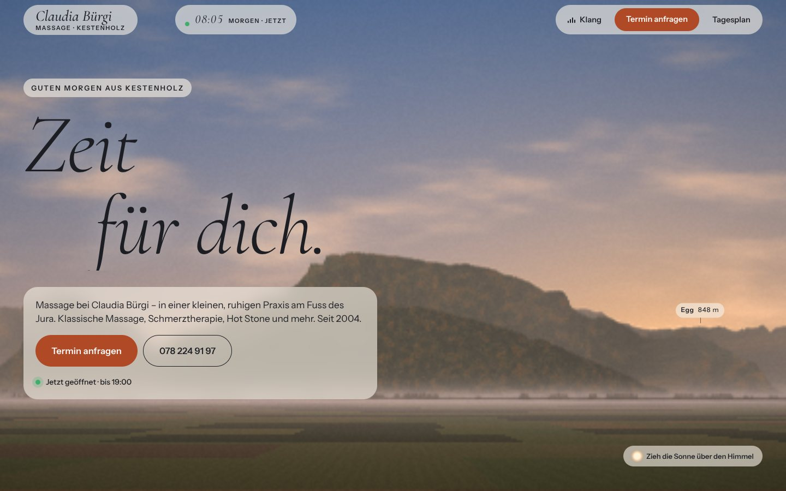
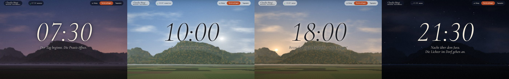
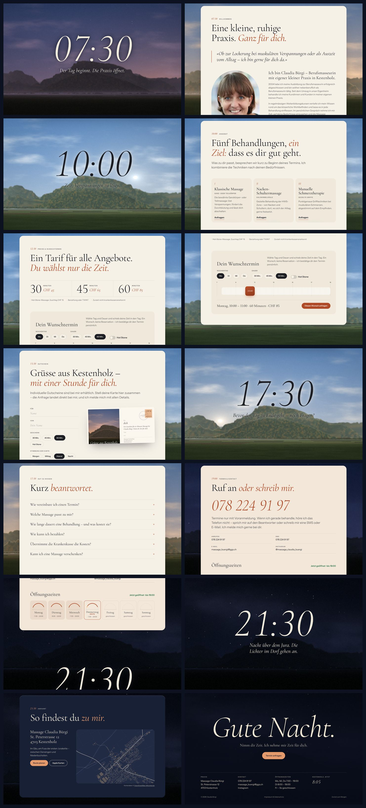
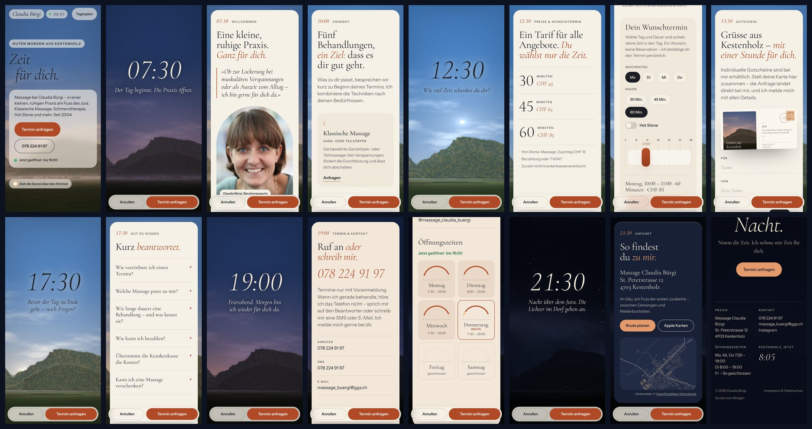

# Massage Claudia Bürgi — «Ein Tag»

The third of three websites for the massage practice of **Claudia Bürgi** in Kestenholz (SO).
It is a static build with no backend, no cookies and no tracking.





<details>
<summary>All sections (desktop & mobile)</summary>




</details>

## Concept — a day at the foot of the Jura

«Zeit für dich.» The practice sells time, so this site is built out of one day.

The background is the view north from St. Peterstrasse 12, painted live in WebGL: Roggenflue, Egg, Rosschopf, Schloss Neu-Bechburg, and Weissenstein far to the west.
The skyline is **not drawn by hand**. 721 sight lines were sampled every 0.25° from the federal height model (swisstopo), so every ridge sits where it really is.
The sun stands where it really stands. Its position is computed for Kestenholz with the NOAA formulas.

When the page opens it shows **right now**: the time, the light and the sky over the practice at this moment.
Scrolling down moves through a story day, from 07:30 when the practice opens to the night over the Jura.
The clock in the header follows the scroll. Sky, light, mist and the village lights change with it.
Header and text switch from dark to light ink as the sky gets dark.

| Hour | What happens |
| --- | --- |
| Loader | Sunrise behind the real Jura silhouette. |
| Jetzt | A greeting for the time of day, «Zeit für dich.», whether the practice is open right now, and the summit names placed on the real peaks. **Drag the sun** across the sky to see the practice at any hour. |
| 07:30 · Über mich | «Der Tag beginnt. Die Praxis öffnet.» Claudia, her story and the facts. |
| 10:00 · Angebot | The five treatments. |
| 12:30 · Preise | The tariff, plus a **planner**: pick a day, a duration and a start time on the opening-hours timeline in 15-minute steps. The sky in the background shows that hour. «So anfragen» fills in the booking request. |
| 15:30 · Gutschein | A voucher **postcard** painted from the same landscape, at morning, noon, evening or night. Add a name and a message, then send the request as an e-mail or SMS. |
| 17:30 · Gut zu wissen | Short answers to the usual questions, also published as FAQ structured data. |
| 19:00 · Kontakt | «Feierabend.» A tap-to-call number. The opening hours are drawn as sun arcs, with today and the current sun position marked. |
| 21:30 · Anfahrt | Night falls and the village lights come on. A street map of Kestenholz drawn from OpenStreetMap data. |
| Footer | «Gute Nacht.» under the stars. |

Extras:

- Optional sound of the landscape («Klang»). It is generated in the browser, with wind over the plain, birds by day, and crickets at dusk and night, and uses no audio files.
- A menu shaped like the day's schedule («Tagesplan»).
- A booking dialog that composes an e-mail or SMS.
- A warm cursor light and a mobile action dock.
- `prefers-reduced-motion` support, print styles, view transitions, and an Impressum and 404 page painted from the same scene.

## Business-first details

- «Termin anfragen» is always one tap away: in the header, the hero, the sections and the mobile dock.
- All real content is semantic HTML. It works without JavaScript; the booking links then lead to the contact section.
- Without WebGL, a painted skyline replaces the live scene and everything else still works.
- On a slow or software-only GPU the scene lowers its resolution and only redraws when something changes.
- The site publishes `HealthAndBeautyBusiness` JSON-LD with address, geo coordinates, opening hours, services, price range and payment methods. It also has an Open Graph image, favicons, a web manifest, `sitemap.xml` and `robots.txt`.
- Fonts are self-hosted, and the page makes **no third-party requests**.

## Development

```bash
npm install
npm run dev       # local dev server
npm run build     # production build → dist/
npm run preview   # serve the build on http://localhost:4176
npm run verify    # (with preview running) browser checks: day/scroll, sun drag, planner, dialog, menu, sizes, fallbacks …
npm run assets    # (with preview running) favicons and share image
```

`verify` and `assets` use Playwright. Run `npm i -D playwright` if it is not installed globally.
The checks run headless Chromium with SwiftShader so that WebGL is available.

The `dist/` folder is a plain static site. Upload it to any static host, such as Netlify, Cloudflare Pages, Vercel, GitHub Pages or a classic web host.
`public/_headers` sets cache and security headers on Netlify and Cloudflare Pages.

## Editing content

All text lives in **`index.html`**. Search for the section comments (`07:30`, `12:30`, `19:00` …).

| Change | Where |
| --- | --- |
| Prices | `index.html` (Preise, booking dialog, JSON-LD `priceRange`), `PRICES` in `src/js/sections/planner.js` and `src/js/core/booking.js`, `GIFTS` in `src/js/sections/postcard.js` |
| Opening hours | `index.html` (Kontakt, footer, JSON-LD), `src/js/utils/helpers.js` (`HOURS`), which drives the open/closed status, the planner and the sun arcs |
| Phone / e-mail | `index.html`, `impressum/index.html`, `src/js/core/booking.js`, `src/js/app.js` |
| Story hours | the `data-hour` attributes in `index.html` (decimal hours, e.g. `19.5` = 19:30) |
| Story date | `STORY_DAY` in `src/js/gl/sun.js` (mid-October: autumn colours, sunset around 18:30) |

## How the landscape works

- `src/data/horizon.json` holds 5 distance bands × 721 directions (azimuth 240°–420°, 0.25° steps). Each entry has the elevation angle of the ridge and its distance. It was sampled from the swisstopo height model (`api3.geo.admin.ch` profile service) from the practice's coordinates.
- `src/js/gl/scene.js` is one full-screen fragment shader that draws:
  - the sky, sun, clouds, stars and Milky Way
  - five ridge layers with autumn forest, pasture, rim light and aerial perspective
  - the plain with fields and hedges
  - the village lights and the valley mist

  Colours are keyed by sun elevation. Scroll, the sun drag and the planner only change uniforms.
- `src/js/gl/sun.js` computes the NOAA sun position and handles Europe/Zurich time, including summer time.

## Structure

```
index.html              one-page site (all content)
impressum/index.html    Impressum & Datenschutz
404.html                «Hier ist nur Nacht.»
public/                 fonts, portrait, icons, og-image, manifest, sitemap, robots, _headers
src/data/horizon.json   the real skyline north of the practice
src/js/gl/              WebGL scene, sun position
src/js/sections/        day (scroll → hour), planner, postcard, hours, FAQ, map, reveals
src/js/core/            scroll locks, loader, header/menu/dock, cursor, booking dialog
src/js/audio/           procedural nature sound
src/styles/             tokens, base, chrome, sections, legal
scripts/                verify.cjs, render-assets.cjs
```

## Credits & licences

- Elevation data: © [swisstopo](https://www.swisstopo.admin.ch/) (federal height model via the geo.admin.ch API, free geodata under the OGD terms of use).
- Map data © [OpenStreetMap contributors](https://www.openstreetmap.org/copyright) (ODbL).
- Typefaces: [Cormorant Garamond](https://github.com/CatharsisFonts/Cormorant) and [Instrument Sans](https://github.com/Instrument/instrument-sans), both under the SIL Open Font License.
- Libraries: GSAP (free standard licence) and Lenis (MIT).
