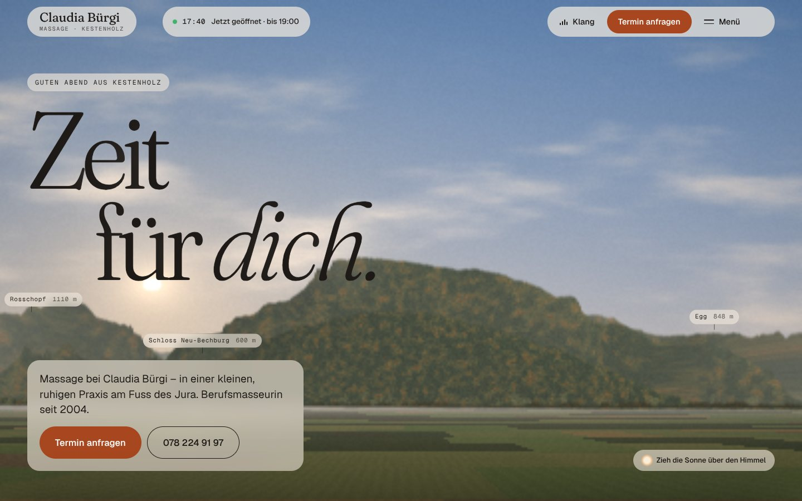
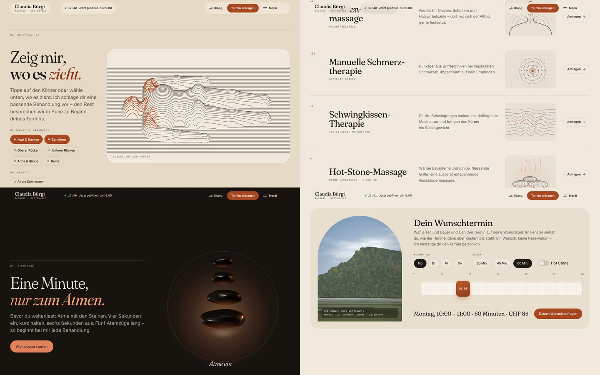
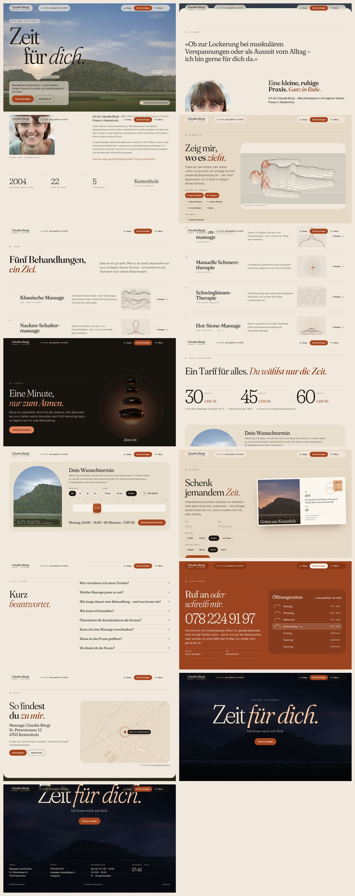
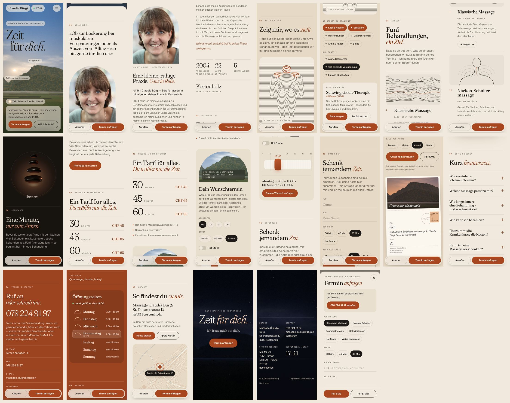

# Massage Claudia Bürgi — «Zeit für dich»

The fourth website for the massage practice of **Claudia Bürgi** in Kestenholz (SO). It combines the best of the first three into one.
It is a static build with no backend, no cookies and no tracking.





<details>
<summary>All sections (desktop & mobile)</summary>




</details>

## Concept — outside, inside, outside

A massage takes you out of the day for an hour, and lets you go again relaxed. The page does the same.

- **Outside, now.** It opens on the real view north from the practice, painted live in WebGL from swisstopo elevation data with the sun where it really stands (from site 3, «Ein Tag»).
- **Inside.** A warm sheet rises over the landscape: linen, sand, basalt and clay (the palette of site 1, «Lass los.»). Here are the practice, the treatments, the prices and the booking.
- **Outside, evening.** At the end the sheet gives way to the same view at dusk, then night: «Zeit für dich.»

One idea runs through all of it: **letting go.** The headlines are set in Fraunces, whose *SOFT* axis turns sharp, tense letters into soft, relaxed ones. Every headline arrives tense and exhales. Letters near your pointer let go a little more, like muscles under a hand (the kinetic letters of site 2, «Entspannung»). The welcome statement relaxes word by word as you read it, the loader is one breath, and the breathing pause moves its headline with your breath.

| Part | What happens | From |
| --- | --- | --- |
| Loader | One breath: «Atme ein» while the real skyline is drawn, «und aus.» while the sun rises. | 3 |
| Hero | «Zeit für dich.» over the sky of Kestenholz right now, with a greeting for the time of day and the summit names on the real peaks. **Drag the sun** to see any hour; double-click returns to now. The header shows whether the practice is open right now. | 3 + 2 |
| 01 Willkommen | Claudia's words relax as you read them. Her portrait opens like an arched window; her story and the facts. | 1 |
| 02 Wo drückt's? | A body on the treatment table, drawn in lines. Tap where it pulls: knots appear, rub them and they settle. A suggested treatment updates as you choose; «So anfragen» fills in the request, including where it pulls. | 2 |
| 03 Angebot | The five treatments, each with its own living line drawing. «Anfragen» on each. | 1 |
| 04 Atempause | One minute with the hot stones: breathing in, the stones lift apart and the ember below them glows; breathing out, they settle and the headline lets go with you. | 1 |
| 05 Preise | One tariff, three durations. The **planner**: pick a day, a duration and a start time; an arched window shows the sky over Kestenholz on that date at that hour. «Diesen Wunsch anfragen» fills in the request. | 3 |
| 06 Gutschein | A postcard painted from the same landscape at morning, noon, evening or night, with name and gift. Sent as a prepared e-mail or SMS. | 3 |
| 07 Gut zu wissen | Short answers; an answered question relaxes. Also published as FAQ structured data. | — |
| 08 Kontakt | The phone number, large. Opening hours as sun arcs with today and the sun's position marked. | 3 |
| 09 Anfahrt | A street map of Kestenholz drawn from OpenStreetMap data. | — |
| Footer | The Jura at dusk turning to night, «Zeit für dich.» fully relaxed. | 3 |

Extras: the sheet cross-fades its colours from section to section, and the header changes with what lies under it (sky, light, dark, clay). An optional sound of the landscape («Klang»; wind, birds, crickets, made in the browser). A menu, a booking dialog that composes an e-mail or SMS, a warm cursor light, a mobile action dock, `prefers-reduced-motion` support, print styles, view transitions, and an Impressum and 404 page painted from the same scene.

## Business-first details

- «Termin anfragen» is always one tap away: in the header, the hero, every treatment, the body map, the planner, the contact section, the footer and the mobile dock.
- The header always says whether the practice is open right now (Europe/Zurich time).
- All real content is semantic HTML. It works without JavaScript; the booking links then lead to the contact section, and each section paints its own colours.
- Without WebGL, a painted skyline replaces the live scene and everything else still works. The shader compiles in the background where the browser supports it; on a slow or software-only GPU the scene lowers its resolution, draws only when something changes, and rests whenever the landscape is covered.
- The site publishes `HealthAndBeautyBusiness` JSON-LD with address, geo coordinates, opening hours, services, price range and payment methods. It also has an Open Graph image, favicons, a web manifest, `sitemap.xml` and `robots.txt`.
- Fonts are self-hosted and slimmed to what the site uses, and the page makes **no third-party requests**.
- Lighthouse (production build): accessibility, best practices and SEO 100 on desktop and mobile. Performance was measured with software-rendered WebGL in a container (desktop ~80, mobile ~70); most of the blocking time is the software GPU compiling the landscape shader, which a real GPU does in the background.

## Development

```bash
npm install
npm run dev       # local dev server
npm run build     # production build → dist/
npm run preview   # serve the build on http://localhost:4178
npm run verify    # (with preview running) 33 browser checks: landscape, kinetic letters, themes, body map, breathing, planner, dialog, menu, sizes, fallbacks, print …
npm run assets    # (with preview running) favicons and share image
```

`verify` and `assets` use Playwright. Run `npm i -D playwright` if it is not installed globally.
The checks run headless Chromium with SwiftShader so that WebGL is available.
`scripts/build-fonts.py` rebuilds the slimmed Fraunces files (needs `pip install fonttools brotli`).

The `dist/` folder is a plain static site. Upload it to any static host, such as Netlify, Cloudflare Pages, Vercel, GitHub Pages or a classic web host.
`public/_headers` sets cache and security headers on Netlify and Cloudflare Pages.

## Editing content

All text lives in **`index.html`**. Search for the section comments (`01 Willkommen`, `05 Preise`, `08 Termin & Kontakt` …).

| Change | Where |
| --- | --- |
| Prices | `index.html` (Preise, booking dialog, JSON-LD `priceRange`), `PRICES` in `src/js/sections/planner.js` and `src/js/core/booking.js`, `PRICE` in `src/js/sections/bodymap.js`, `GIFTS` in `src/js/sections/postcard.js` |
| Opening hours | `index.html` (Kontakt, footer, JSON-LD), `src/js/utils/helpers.js` (`HOURS`), which drives the open/closed status, the planner and the sun arcs |
| Phone / e-mail | `index.html`, `impressum/index.html`, `src/js/core/booking.js`, `src/js/app.js` |
| Treatment suggestions | `src/js/sections/bodymap.js` (`recommend`) |
| Portrait | `public/images/claudia-buergi.webp` |

## Structure

```
index.html              one-page site (all content)
impressum/index.html    Impressum & Datenschutz
404.html                «Nichts hier. Nur Ruhe.»
public/                 fonts, portrait, stones, icons, og-image, manifest, sitemap, robots, _headers
src/data/horizon.json   the real skyline north of the practice (swisstopo)
src/js/gl/              WebGL landscape, sun position
src/js/core/            kinetic letters, pointer, scroll locks, loader, header/themes/menu, cursor, booking dialog
src/js/sections/        landscape (hero & footer), reveals, body map, signets, breath, planner, postcard, hours, FAQ, map
src/js/audio/           procedural nature sound
src/styles/             tokens, base, chrome, sections, legal
scripts/                verify.cjs, render-assets.cjs, build-fonts.py
```

## Credits & licences

- Elevation data: © [swisstopo](https://www.swisstopo.admin.ch/) (federal height model via the geo.admin.ch API, free geodata under the OGD terms of use).
- Map data © [OpenStreetMap contributors](https://www.openstreetmap.org/copyright) (ODbL).
- Typefaces: [Fraunces](https://github.com/undercasetype/Fraunces) and [Geist](https://github.com/vercel/geist-font), both under the SIL Open Font License.
- Libraries: GSAP (free standard licence) and Lenis (MIT).
